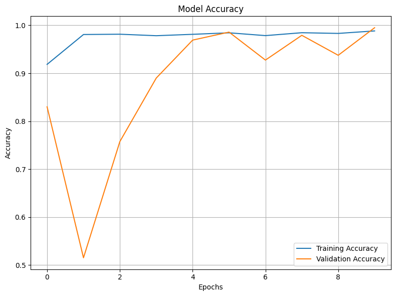
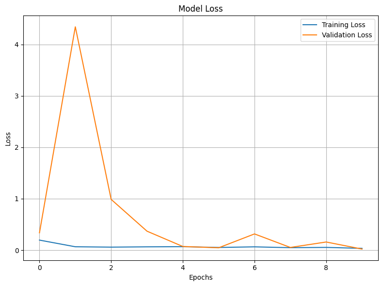

# Keras CNN Satellite Image Classifier

Training and evaluating a **convolutional neural network (CNN) in Keras** that classifies 64 x 64 satellite image tiles as **agricultural** or **non-agricultural** land, with data augmentation, batch normalization, dropout and checkpointing of the best model.


---

## Table of Contents

1. [Overview](#overview)
2. [Dataset](#dataset)
3. [Project Workflow](#project-workflow)
4. [Model Architecture](#model-architecture)
5. [Training Setup](#training-setup)
6. [Results](#results)
7. [What I Learned](#what-i-learned)
8. [Repository Structure](#repository-structure)
9. [Getting Started](#getting-started)
10. [Limitations and Future Work](#limitations-and-future-work)
11. [Tech Stack](#tech-stack)
12. [Acknowledgements](#acknowledgements)
13. [License](#license)

---

## Overview

Land-use classification from satellite imagery supports tasks such as monitoring farmland and planning land use. This project trains a CNN to separate **agricultural** tiles (label 1) from **non-agricultural** tiles (label 0), and it covers the whole training workflow:

- Reading images from folders with `ImageDataGenerator`
- Augmenting the training data (rotation, shifts, shear, zoom, flips)
- Building a CNN with convolution, batch normalization, dropout and dense layers
- Training with `binary_crossentropy` and the Adam optimizer
- Saving the best model automatically with `ModelCheckpoint`
- Evaluating on a held-out validation set and plotting accuracy and loss

## Dataset

Satellite image tiles (file names follow the Sentinel-2 `S2A_MSIL2A` convention), downloaded automatically in the notebook (about 20 MB):

```
https://cf-courses-data.s3.us.cloud-object-storage.appdomain.cloud/4Z1fwRR295-1O3PMQBH6Dg/images-dataSAT.tar
```

| Property | Value |
|---|---|
| Classes | 2 (`class_0_non_agri` = 0, `class_1_agri` = 1) |
| Images | 6,000 in total (3,000 per class) |
| Image size | 64 x 64 pixels, RGB |
| Training / validation split | 4,800 / 1,200 (80% / 20%) |

```
images_dataSAT/
├── class_0_non_agri/    # non-agricultural land (label 0)
└── class_1_agri/        # agricultural land (label 1)
```

## Project Workflow

| Step | Task | What was done |
|---|---|---|
| 1 | Setup | Installed and imported TensorFlow 2.19, scikit-learn, NumPy and Matplotlib; set random seeds (7331) |
| 2 | Data download | Downloaded and extracted the dataset; counted the 6,000 files |
| 3 | Data generators | `ImageDataGenerator` for training (with augmentation) and a separate plain generator for validation (rescaling only, `shuffle=False`) |
| 4 | Model | A Sequential CNN with 4 convolution blocks and a 4-layer dense head |
| 5 | Compile and callbacks | Adam (lr = 0.001), `binary_crossentropy`, `ModelCheckpoint` monitoring `val_accuracy` |
| 6 | Training | 10 epochs, batch size 128, on CPU |
| 7 | Evaluation | Validation accuracy per epoch, a scikit-learn accuracy check on the validation generator, and accuracy and loss curves |

**Training augmentation:** rotation up to 40 degrees, width and height shifts of 20%, shear 20%, zoom 20%, horizontal flip, `fill_mode="nearest"`.

## Model Architecture

```
Input (64 x 64 x 3)
  |
4 x [ Conv2D (5x5, ReLU, same padding) -> MaxPooling2D(2x2) -> BatchNormalization ]
      filters: 32 -> 64 -> 128 -> 256
  |
GlobalAveragePooling2D
  |
4 x [ Dense (ReLU) -> BatchNormalization -> Dropout(0.4) ]
      units: 64 -> 128 -> 256 -> 512
  |
Dense(1, sigmoid)         # probability of "agricultural"
```

The model has about **1.27 million parameters** (calculated from the layer sizes). All convolution and dense layers use `HeUniform` initialization.

## Training Setup

| Setting | Value |
|---|---|
| Loss | Binary cross-entropy |
| Optimizer | Adam, learning rate 0.001 |
| Batch size | 128 |
| Epochs | 10 |
| Checkpoint | Best model by `val_accuracy`, saved as `ai_capstone_keras_best_model.model.keras` |
| Hardware | CPU (about 4 minutes per epoch, about 42 minutes in total) |

## Results

| Metric | Value |
|---|---|
| **Final validation accuracy (epoch 10, best checkpoint)** | **99.50%** |
| Final validation loss | 0.0208 |
| Final training accuracy | 98.83% |
| Final training loss | 0.0347 |

Per-epoch history:

| Epoch | Train accuracy | Train loss | Validation accuracy | Validation loss |
|---|---|---|---|---|
| 1 | 0.9185 | 0.1950 | 0.8300 | 0.3371 |
| 2 | 0.9808 | 0.0655 | 0.5150 | 4.3425 |
| 3 | 0.9815 | 0.0583 | 0.7575 | 0.9866 |
| 4 | 0.9783 | 0.0640 | 0.8900 | 0.3686 |
| 5 | 0.9812 | 0.0669 | 0.9692 | 0.0708 |
| 6 | 0.9844 | 0.0521 | 0.9858 | 0.0457 |
| 7 | 0.9785 | 0.0640 | 0.9275 | 0.3152 |
| 8 | 0.9846 | 0.0476 | 0.9792 | 0.0522 |
| 9 | 0.9831 | 0.0531 | 0.9375 | 0.1582 |
| **10** | **0.9883** | **0.0347** | **0.9950** | **0.0208** |





Validation accuracy is unstable in the middle epochs (for example 51.5% at epoch 2 and 92.8% at epoch 7) and settles near 99% at the end. Training accuracy is slightly lower than validation accuracy at times because the training data is augmented and dropout is active during training.

## What I Learned

My first run used only **3 epochs** and reused the augmented generator for validation. It reached about **98% training accuracy but only about 50% validation accuracy**, which is chance level for two classes. I made two changes at once:

1. Gave validation its own generator with **no augmentation** (rescaling only, `shuffle=False`), so validation reflects real, unmodified images.
2. Increased training from 3 to **10 epochs**. With many BatchNorm layers, the running statistics need enough training steps before inference behaves well.

After both changes, validation accuracy reached 99.5%. Because I changed both at once, I can't say how much each one contributed. Testing them separately would show it.

## Repository Structure

```
keras-cnn-satellite-classifier/
├── notebooks/
│   └── Keras_CNN_Satellite_Classifier.ipynb   # Full notebook with outputs
├── images/
│   ├── accuracy_curve.png
│   └── loss_curve.png
├── .gitignore
├── LICENSE
├── README.md
└── requirements.txt
```

## Getting Started

### Prerequisites

- Python 3.9 to 3.12
- An internet connection (the dataset downloads when the notebook runs)
- Roughly 40 minutes for the full 10-epoch run on a CPU

### Installation

```bash
# 1. Clone the repository
git clone https://github.com/<your-username>/keras-cnn-satellite-classifier.git
cd keras-cnn-satellite-classifier

# 2. (Recommended) create a virtual environment
python -m venv .venv
source .venv/bin/activate        # Windows: .venv\Scripts\activate

# 3. Install dependencies
pip install -r requirements.txt
```

### Run the notebook

```bash
jupyter notebook notebooks/Keras_CNN_Satellite_Classifier.ipynb
```

Use **Kernel > Restart & Run All**. The dataset is extracted to `images_dataSAT/` and the best model is saved as `ai_capstone_keras_best_model.model.keras`. Both are ignored by git.

> The notebook starts with `%pip install` cells written for the Skills Network Labs environment. If you installed the dependencies with `requirements.txt`, you can skip them. The scikit-learn accuracy cell in the evaluation section only gives meaningful numbers after the training cell has finished.

## Limitations and Future Work

- **No separate test set.** The checkpoint is chosen using validation accuracy, and the same validation set is used to report the result, so 99.5% is slightly optimistic. A held-out test set would give an unbiased estimate.
- **Unstable validation curve.** The swings between epochs suggest the BatchNorm and dropout stack is heavy for 4,800 training images. A lighter dense head or a lower BatchNorm momentum may help.
- Only accuracy and loss are reported. Adding a confusion matrix, precision, recall and F1 per class would give a fuller picture.
- Possible improvements: transfer learning (for example MobileNet or ResNet), a learning-rate schedule, early stopping and a seeded, reproducible comparison of settings.
- Add Grad-CAM heatmaps to show which image regions drive the predictions.

## Tech Stack

- **Python**
- **TensorFlow / Keras**: CNN, `ImageDataGenerator`, callbacks
- **scikit-learn**: accuracy metric
- **NumPy** and **Matplotlib**: arrays and plots
- **skillsnetwork**: dataset download helper
- **Jupyter Notebook**

## Acknowledgements

- Completed as part of the IBM AI Engineering course (IBM Skills Network). The lab structure, instructions and dataset are from that course and are © IBM Corporation.
- My work in the notebook: the data generators, the CNN architecture used for training, the training and checkpoint setup, the debugging of the low validation accuracy, and the evaluation plots.

## License

My code is released under the [MIT License](LICENSE). The lab instructions and dataset remain © IBM Corporation.
